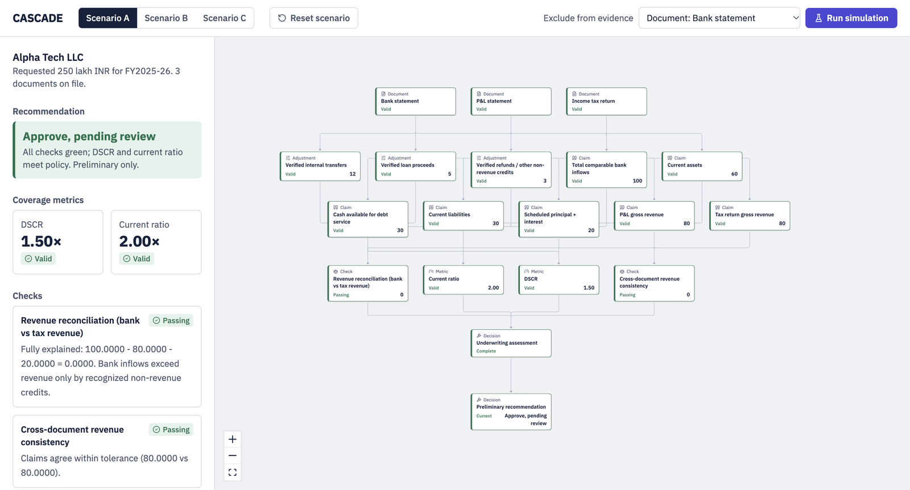
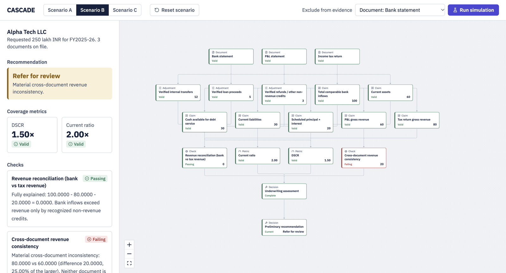
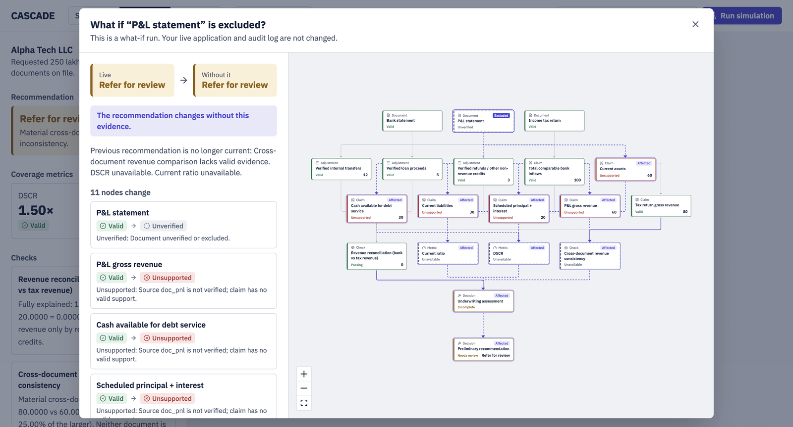
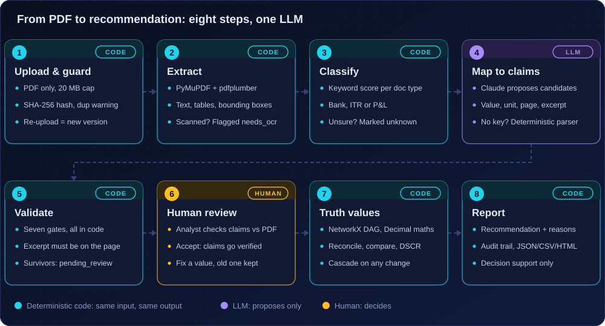
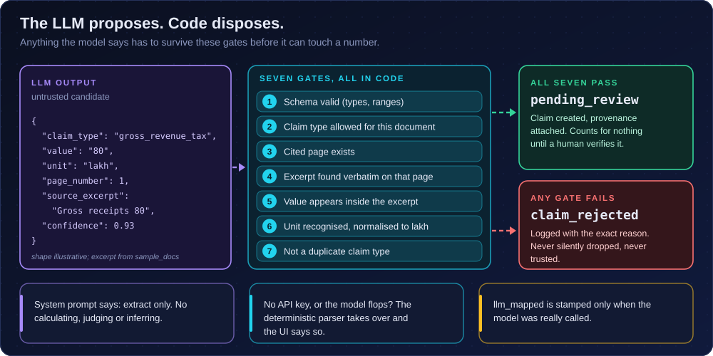
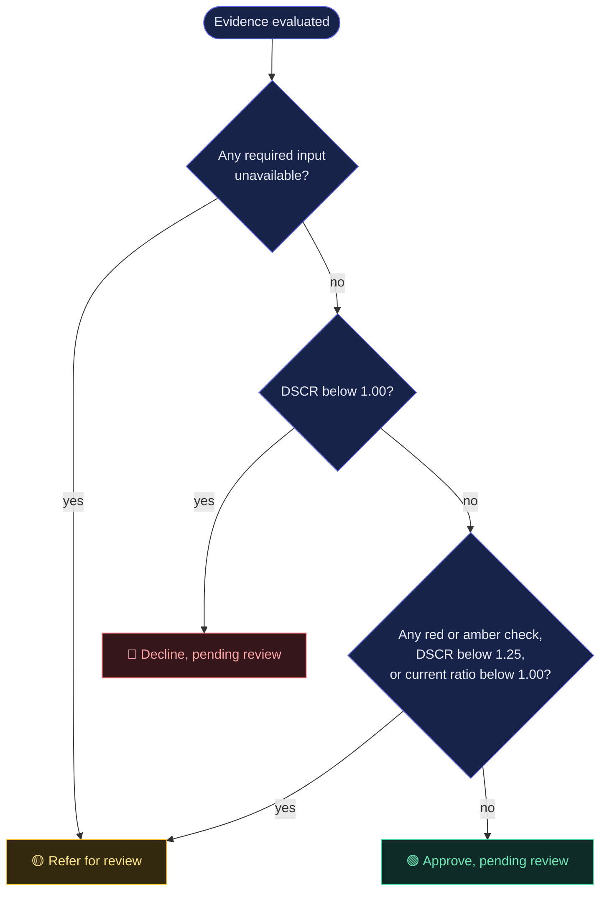
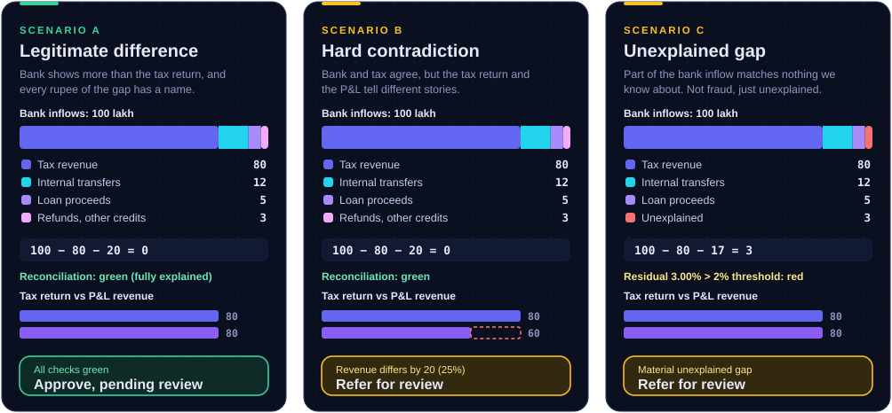
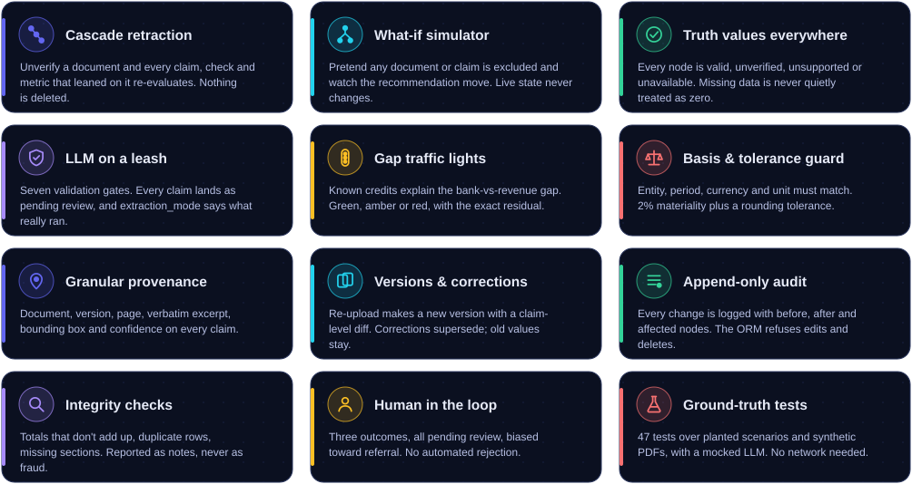

<div align="center">



<br/>


-A78BFA?style=for-the-badge)


### An LLM reads the paperwork. Deterministic code does the thinking.
### When something doesn't add up, the loan file says so, and says exactly why.

[**The idea**](#the-idea) &nbsp;·&nbsp; [**See it work**](#see-it-in-action) &nbsp;·&nbsp; [**How it works**](#how-it-works) &nbsp;·&nbsp; [**What we built**](#what-we-built) &nbsp;·&nbsp; [**Run it**](#run-it) &nbsp;·&nbsp; [**Limits**](#what-it-doesnt-do-yet)

</div>


## The idea

Alpha Tech LLC asks for **₹250 lakh**. Three PDFs land on an analyst's desk: a bank statement, a P&L, an income tax return.

The bank statement says ₹100 lakh came in. The tax return says revenue was ₹80 lakh. Is that a problem?

Maybe not. ₹12 lakh could be transfers between the company's own accounts, ₹5 lakh a loan disbursement, ₹3 lakh a refund. Maybe so. The usual ways to find out aren't great:

- **A person** reads three documents side by side, with a calculator, for hours.
- **A chatbot** reads each PDF on its own, does the arithmetic in its head, and sounds exactly as sure when it's wrong as when it's right.

And then on day three the founder emails a corrected P&L. Which of your conclusions just went stale? Nobody can say without starting over.

**CASCADE treats a loan file the way a spreadsheet treats numbers.** Every figure knows which document it came from, what it depends on, and what depends on it. Pull one thread and the consequences ripple down the graph: that's the cascade.

### The one rule

> **The LLM perceives. Code decides.**

An LLM is great at reading messy documents and bad at being trusted with arithmetic. So we gave it only the part it's good at. It reads text and *proposes* candidate numbers. Everything after that, from checking those numbers to building the dependency graph to picking the recommendation, is plain deterministic code. Same input, same answer, every time.

The mechanism underneath is a **truth-value system**: every node in the graph carries a status (`valid`, `unverified`, `unsupported`, `unavailable`), and a derived node can only be computed from parents that are `valid`. If you've met a *truth maintenance system* in an AI course, it's that idea, pointed at loan files.

| Truth value | What it means | Example |
|---|---|---|
| 🟢 **valid** | Backed by a verified source document | Bank inflows: 100, from a verified bank statement |
| ⚪ **unverified** | Not trusted yet, or deliberately excluded | An analyst flags the P&L |
| 🔴 **unsupported** | The claim was fine, but its source document no longer is | P&L revenue, after the P&L is flagged |
| ⚫ **unavailable** | No evidence at all. **Never treated as zero** | DSCR with no debt-service figure |

Checks add `passing / failing`, assessments add `complete / incomplete`, and the final recommendation is either `current` or `needs review`.


## See it in action

This is the real UI running on the seeded Alpha Tech LLC file (all data is synthetic). Same company, same documents, different story:

<table>
<tr>
<td width="50%" align="center"><b>Scenario A: everything reconciles</b><br/><sub>Bank gap fully explained, all checks green</sub></td>
<td width="50%" align="center"><b>Scenario B: documents disagree</b><br/><sub>Tax return says 80, P&L says 60</sub></td>
</tr>
<tr>
<td></td>
<td></td>
</tr>
</table>

### The 60-second tour

1. **Scenario A.** Everything is green. Preliminary call: *Approve, pending review*. DSCR 1.50×, current ratio 2.00×.
2. **Scenario B.** Same company, but the P&L now disagrees with the tax return. The check goes red, the recommendation flips to *Refer for review*, and the side panel spells out the numbers (80 vs 60, a 25% gap).
3. **Exclude a document, hit Run simulation.** A what-if modal shows exactly which nodes lose their footing.
4. **Retract for real** with one `curl` ([below](#try-the-cascade-from-the-terminal)) and read the audit trail it leaves behind.

### One click, eleven nodes

Below is the engine's actual output for Scenario A when an analyst marks the **P&L statement unverified**. Watch what moves, and what doesn't. The bank and tax branch never flinches, because nothing in it depended on the P&L.

<div align="center">

</div>

Nothing gets deleted. Retracted nodes keep their values and explain themselves (`Source doc_pnl is not verified; claim has no valid support`), so putting the document back restores everything. Both directions are in the audit log.

### "What if we ignored this document?"

The **Exclude from evidence** dropdown runs a counterfactual: the engine re-evaluates the whole graph as if one document, claim or adjustment didn't exist, and shows you a side-by-side. It's a sandbox. Your live application and audit log aren't touched.

<div align="center">

<br/><sub>Scenario B with the P&L excluded. Still "Refer for review", but now for a different reason: there's no valid evidence left to compare, and the panel tells you which nodes lost support and why.</sub>
</div>

> [!IMPORTANT]
> **CASCADE is decision support, not a decision-maker.** It never auto-rejects, never calls a discrepancy fraud, never lets an LLM write a number, and never pretends the LLM ran when it didn't. Every output ends in a human.


## How it works

<div align="center">

</div>

Only step 4 involves a model, and it's optional. With no API key a simpler deterministic parser does the same job and the UI reports `deterministic_fallback`. `llm_mapped` shows up only when the model was genuinely called.

### The LLM is on a leash

A model's output is treated like input from a stranger. Each candidate claim has to get through seven gates before it exists:

<div align="center">

</div>

The gate that matters most is #4. The model has to quote the line it got the number from, and that line has to exist, verbatim, on the page it cites. A made-up figure has nowhere to hide: it has to sit in a line that's really on the page.

### From evidence to answer

The graph is built by programmatic rules, never by a model: `Document → Claim → Check / Metric → Assessment → Recommendation`. Four rules turn claims into judgments:

| Rule | What it computes | Verdict |
|---|---|---|
| **Revenue reconciliation** | `residual = bank inflows − tax revenue − verified non-revenue credits` | 🟢 residual ≈ 0 &nbsp; 🟡 small residual, or *over*-explained &nbsp; 🔴 residual above 2% of inflows |
| **Cross-document consistency** | Tax return revenue vs P&L revenue | 🟢 within 2% &nbsp; 🔴 beyond it (neither document is presumed wrong) |
| **DSCR** | cash available for debt service ÷ scheduled principal + interest | Policy floor 1.25 |
| **Current ratio** | current assets ÷ current liabilities | Policy floor 1.00 |

Before any comparison runs, CASCADE checks that both claims share the same **entity, period, currency and unit**. If they don't, the rule is *not applied* rather than applied wrongly. Amounts in lakh, crore and rupees are normalised to lakh first.

Then the recommendation. It leans hard toward a human:



Even the "decline" is only ever *pending review*. Nothing in the system can reject an application on its own.


## The three scenarios

We planted one clean case and two different kinds of trouble, so you can see the engine tell them apart. Load any of them from the UI tabs, or with `POST /demo/load`.

<div align="center">

</div>

The point of Scenario A is as much about what CASCADE *doesn't* flag. A naïve "bank ≠ tax" check would scream about a ₹20 lakh gap. CASCADE sees that transfers, loan proceeds and refunds account for all of it and stays green. Scenario C is the same bank statement with the refund unrecognised, leaving ₹3 lakh (3.00%) with no name. That's enough to cross the line, and the message says "requires human review; this is not a finding of fraud".


## What we built

<div align="center">

</div>

### Why this isn't just "an LLM over PDFs"

| | A typical LLM-over-PDFs pipeline | CASCADE |
|---|---|---|
| **Who does the maths** | The model, in its head | Python `Decimal` in pure functions with no I/O and no LLM |
| **Across documents** | Each file read on its own | One dependency graph spanning all of them |
| **A document changes** | Start over | Only dependents re-evaluate, with a before/after diff |
| **Evidence is missing** | Often glossed over | `unavailable`, never zero. The call degrades to *refer* |
| **"Why did it say that?"** | Scroll the chat history | Node, rule, inputs and residual, in plain language |
| **The LLM is down** | The product is down | Deterministic parser takes over, and the UI says so |
| **Audit** | Hope you saved it | Append-only event log, enforced at the ORM level |

### Details worth a closer look

<details>
<summary><b>Provenance on every claim</b></summary>

<br/>

Each claim carries the document, document *version*, page number, the verbatim source excerpt, a bounding box on the page, an extraction confidence, and the `extraction_mode` that produced it (`pdf_extraction`, `deterministic_fallback`, `llm_mapped`, `demo_fixture` or `manual_correction`). Claims under 0.6 confidence or with negative values are flagged before anyone verifies them.
</details>

<details>
<summary><b>Versioning, re-uploads and corrections</b></summary>

<br/>

Every upload is hashed (SHA-256) and stored as a new version of the same document, with a duplicate warning if you've uploaded identical bytes before. A claim-level diff shows what moved between versions. When an analyst corrects a number, the old claim is superseded, not overwritten, so the history stays queryable.
</details>

<details>
<summary><b>Document integrity checks</b></summary>

<br/>

Totals that don't equal the sum of the rows above them, identical rows repeated in a table, expected sections that are missing, pages with no extractable text. PDF metadata is recorded as information only. We were careful here: none of this is an authenticity score, and none of it is ever worded as forgery.
</details>

<details>
<summary><b>Scanned PDFs and bad input</b></summary>

<br/>

Only real PDFs under 20 MB get in (extension, size and `%PDF` header are all checked). A scanned PDF with no text layer is reported as `needs_ocr` instead of being guessed at. Garbage in produces a clean failure, not a fabricated claim.
</details>

<details>
<summary><b>Reports</b></summary>

<br/>

`GET /applications/{id}/report` returns JSON, with `.csv` and `.html` variants. It lists documents and versions, integrity findings, every check with its evidence, metrics with their inputs and limitations, evidence gaps, unverified claims, the recommendation with reasons, and the last 50 audit events. Built only from engine output; a model never supplies a figure. It follows the four dimensions in our design doc: consistency, document integrity, credit risk, and the decision.
</details>


## Run it

You need Python 3.12 and Node 18+. No API key is required.

**1. Backend**

```bash
cd backend
python -m venv .venv
source .venv/bin/activate          # Windows: .\.venv\Scripts\Activate.ps1
pip install -r requirements.txt
uvicorn app.main:app --reload --port 8000
```

API on `http://localhost:8000`, Swagger UI on `/docs`. The server creates the tables and seeds Alpha Tech LLC on startup.

**2. Frontend**

```bash
cd frontend
npm install
npm run dev                        # http://localhost:5173
```

**Prefer Docker for the API?** `docker compose up --build` serves it on `:8000` with SQLite on a volume. (PostgreSQL is available behind `--profile postgres`.)

**Want the LLM in the loop?** Set `ANTHROPIC_API_KEY` in the environment before starting the API (`export ANTHROPIC_API_KEY=...`, or `$env:ANTHROPIC_API_KEY="..."` in PowerShell; see `.env.example` for the other settings). Leave it unset and the deterministic parser is used.

### Try the cascade from the terminal

```bash
# load scenario A (everything green)
curl -X POST localhost:8000/demo/load -H 'Content-Type: application/json' -d '{"scenario":"A"}'

# find the P&L document and mark it unverified
DOC=$(curl -s localhost:8000/applications/app_alpha_tech/documents \
      | jq -r '.[] | select(.doc_type=="profit_and_loss") | .id')
curl -X POST localhost:8000/documents/$DOC/verify \
     -H 'Content-Type: application/json' \
     -d '{"status":"unverified","reason":"Figures do not match the tax return"}'
# -> 11 changed nodes, downstream_order, and the new recommendation

# read the audit trail, run a what-if, grab the report
curl localhost:8000/applications/app_alpha_tech/audit
curl -X POST localhost:8000/applications/app_alpha_tech/simulate \
     -H 'Content-Type: application/json' -d '{"excluded_node_id":"doc_bank"}'
curl localhost:8000/applications/app_alpha_tech/report.html
```

**Real PDFs:** upload the files in `backend/sample_docs/` to a new application (`POST /applications/{id}/documents`), look at the extracted claims, then `POST /documents/{id}/review/accept`.

<details>
<summary><b>API cheat sheet</b></summary>

<br/>

| Endpoint | What it does |
|---|---|
| `POST /demo/load` · `POST /demo/reset` | Load scenario `A`, `B` or `C`; reset to the original synthetic state |
| `GET /applications/{id}/graph` | The dependency graph, ready for React Flow |
| `GET /applications/{id}/checks` · `/claims` | Checks with their evidence; current claims |
| `POST /documents/{id}/verify` | Mark a document `verified` / `unverified` and cascade |
| `POST /claims/{id}/verify` · `/correct` | Verify or correct one claim; history preserved |
| `POST /applications/{id}/simulate` | What-if: exclude any evidence node, live state untouched |
| `POST /applications/{id}/recalculate` | Full recalculation from current evidence |
| `GET /applications/{id}/audit` | Append-only audit events |
| `POST /applications/{id}/documents` | Upload a PDF (extract → classify → map → validate) |
| `POST /documents/{id}/versions` · `GET /documents/{id}/diff` | New version of a document; claim-level diff |
| `POST /documents/{id}/confirm-type` · `/review/accept` | Human confirms the type; human accepts the extraction |
| `GET /applications/{id}/report` (`.csv`, `.html`) | The report |
| `GET /health` | Status, and whether an LLM is configured |

</details>

<details>
<summary><b>Where things live</b></summary>

<br/>

```text
backend/app/
├── services/
│   ├── rules.py            # financial rules: pure functions, Decimal, no I/O, no LLM
│   ├── engine.py           # NetworkX DAG, truth values, cascade, what-if simulation
│   ├── claim_mapping.py    # LLM + deterministic mapping, the seven validation gates
│   ├── pdf_extraction.py   # PyMuPDF + pdfplumber: text, tables, bounding boxes
│   ├── ingestion.py        # upload, versions, SHA-256 dedupe, diffs
│   ├── integrity.py        # totals, duplicate rows, missing sections, metadata notes
│   ├── workflow.py         # verify / correct / simulate, each with an audit event
│   ├── state_store.py      # database <-> engine
│   └── report.py           # JSON / CSV / HTML report
├── api/                    # FastAPI routes
├── db/                     # SQLAlchemy models, sessions, seeding (SQLite or PostgreSQL)
└── schemas/                # Pydantic models
backend/sample_docs/        # three synthetic PDFs for Alpha Tech LLC
backend/tests/              # 47 tests, mocked LLM, no network
frontend/src/               # React + TypeScript + Tailwind v4 + @xyflow/react
```

</details>

### Tests

```bash
cd backend && python -m pytest tests -q        # 47 passed
```

They run on fixed synthetic data and a mocked LLM client, so no network is needed. The suite covers the three planted scenarios, cascade and restore, an independent branch staying untouched, corrections preserving history, simulations not mutating live state, missing evidence being `unavailable` rather than zero, incompatible bases blocking a comparison, the append-only audit log, upload validation, validated LLM mapping, and scanned PDFs being reported instead of invented.


## What it doesn't do yet

We'd rather tell you than have you find out.

- **Uploads are API-first.** The UI is the graph, the dashboard, the scenarios and the what-if tool. Uploading and reviewing PDFs currently happens through the API (Swagger makes it painless).
- **No OCR.** Scanned PDFs are flagged `needs_ocr`, not read.
- **Narrow scope on purpose.** Three document types, one entity, INR and lakh, one financial year. The architecture is general; the demo is deliberately small so every path is tested.
- **Explanations are written by the engine,** as deterministic text built from the execution trace. An LLM narrator could sit on top, but it would be read-only: it may describe graph state, never change it.
- **No document-trust ranking yet.** Suggesting which document deserves more authority, with human override, is on the list.
- **Schema via `create_all`.** No Alembic migrations yet; use `python -m app.db.init_db --reset` after model changes (SQLite dev).

<!--
## Team
Add names, roles and links here, e.g.
- **Name**: what they built ([GitHub](https://github.com/...))
-->


<div align="center">
<sub>
Preliminary decision-support output generated by deterministic rules from synthetic or extracted evidence.<br/>
It is not a credit decision. Discrepancies are not findings of fraud; they require human review.
</sub>
</div>
